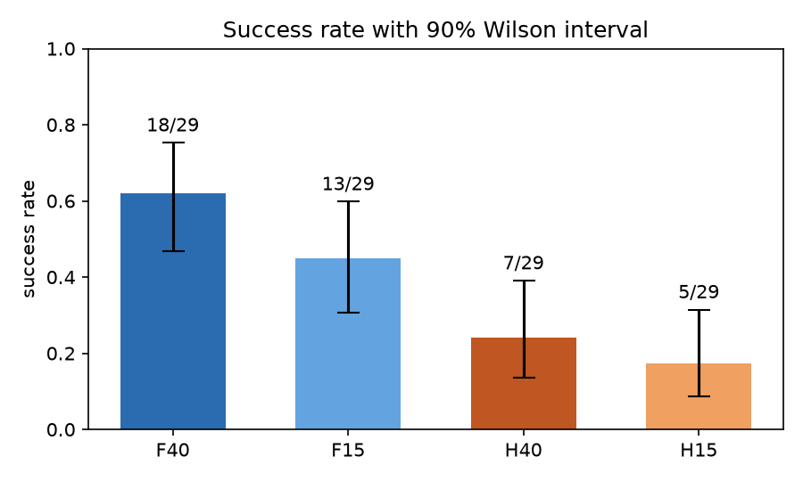
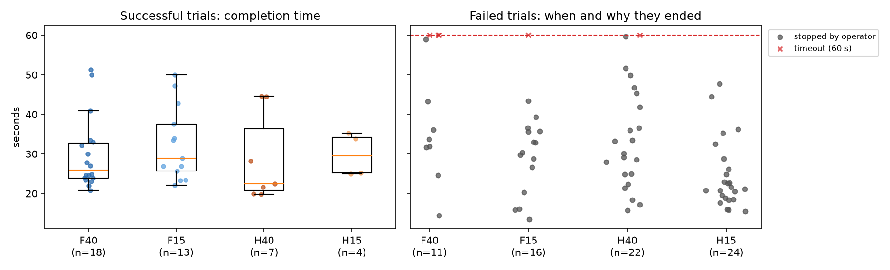
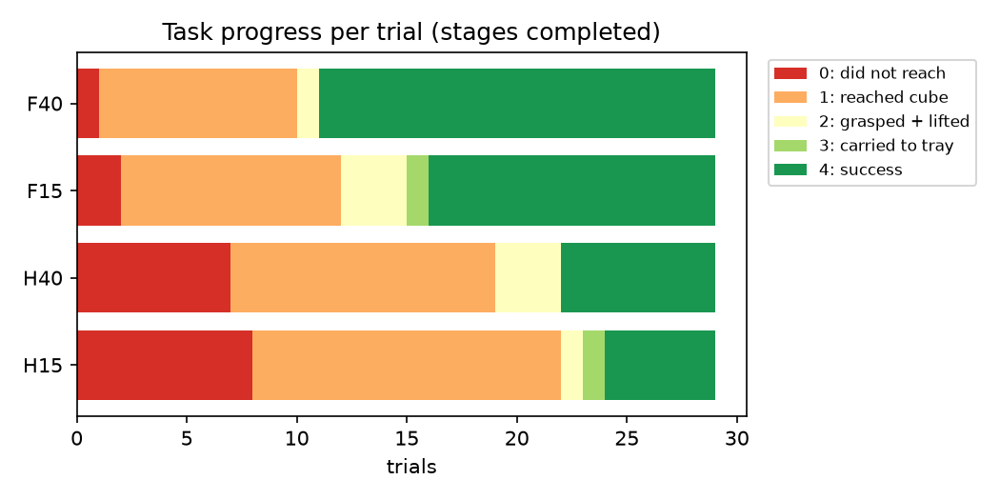
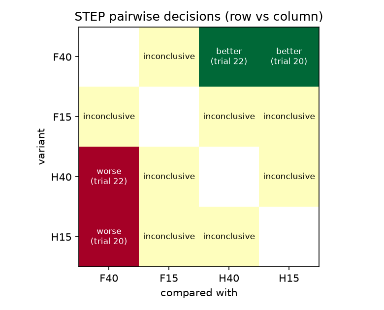
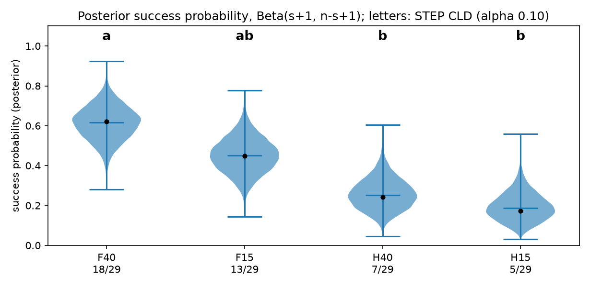

# Task 1 results: cube placement with ACT

**Question.** Does ACT succeed more often when trained on all 147 demonstrations instead of a random half (73), and
when it executes 40 instead of 15 of the 50 actions it predicts per chunk?

**Variants.** Two ACT policies (chunk 50, no VAE, step 45 000; their training configs differ only in the episodes),
each run with two execution horizons:

| Variant | Full form | Training data | Actions executed per predicted chunk of 50 |
|---|---|---|---|
| **F40** | Full data, execute 40 | all 147 demonstrations | 40 |
| **F15** | Full data, execute 15 | all 147 demonstrations | 15 |
| **H40** | Half data, execute 40 | random half, 73 demonstrations | 40 |
| **H15** | Half data, execute 15 | random half, 73 demonstrations | 15 |

**Online.** This folder with every rollout video (wrist + scene, plays in the browser):
[faizalkarim/hrl_A2_task1_results](https://huggingface.co/datasets/faizalkarim/hrl_A2_task1_results), under `rollouts/<id>/`.
`logs/manifest.csv` gives each rollout's variant, configuration and outcome with direct video links (`url_wrist`, `url_scene`).

**Protocol.** 29 matched configurations (cube + tray pose), each run once per variant (116 rollouts), in randomised
configuration and variant order, labelled blind. 30 Hz, timeout 60 s, arm commands limited to
0.75 deg/step (gripper unlimited), same for all variants. **Success:** cube in the tray, gripper released,
arm lifted.

## 1. Successes and failures

| variant | policy / executed | successes | failures | trials | success rate | 90% Wilson CI |
|---|---|---|---|---|---|---|
| F40 | full / 40 | 18 | 11 | 29 | 0.62 | [0.47, 0.75] |
| F15 | full / 15 | 13 | 16 | 29 | 0.45 | [0.31, 0.60] |
| H40 | half / 40 | 7 | 22 | 29 | 0.24 | [0.14, 0.39] |
| H15 | half / 15 | 5 | 24 | 29 | 0.17 | [0.09, 0.31] |

Binary success; 90% Wilson score interval per variant. The intervals describe each variant's own uncertainty;
their overlap is not the comparison (section 4).

## 2. Completion time

Successful trials, from the start of policy execution until the success criterion was met:

| variant | successful trials | timed | median (s) | IQR (s) |
|---|---|---|---|---|
| F40 | 18 | 18 | 26.0 | [23.9, 32.7] |
| F15 | 13 | 13 | 29.0 | [25.7, 37.5] |
| H40 | 7 | 7 | 22.4 | [20.7, 36.3] |
| H15 | 5 | 4 | 29.6 | [25.2, 34.2] |

Unsuccessful trials: ended at the timeout, or stopped earlier by the operator once the rollout had clearly failed
(gripper stuck at the cube, cube knocked away or dropped):

| variant | failed trials | timeout at 60 s | stopped by operator (time) |
|---|---|---|---|
| F40 | 11 | 3 | 8 (median 32.8 s, range 14.4–59.0 s) |
| F15 | 16 | 1 | 15 (median 30.4 s, range 13.5–43.5 s) |
| H40 | 22 | 1 | 21 (median 30.1 s, range 15.7–59.6 s) |
| H15 | 24 | 0 | 24 (median 21.3 s, range 15.5–47.7 s) |

One H15 success (r0065) has no recorded time: it was ended with the failure key by mistake and relabelled (section 6).

## 3. Task progress and failures

Partial score, 0.25 per completed stage (reach the cube, grasp + lift, carry over the tray, place + release); reported
separately from binary success and not used in STEP. Number of trials per score:

| variant | mean progress | 0 | 0.25 | 0.5 | 0.75 | 1 (success) |
|---|---|---|---|---|---|---|
| F40 | 0.72 | 1 | 9 | 1 | 0 | 18 |
| F15 | 0.61 | 2 | 10 | 3 | 1 | 13 |
| H40 | 0.40 | 7 | 12 | 3 | 0 | 7 |
| H15 | 0.34 | 8 | 14 | 1 | 1 | 5 |

Where the failed trials stopped progressing:

| failed while | F40 | F15 | H40 | H15 |
|---|---|---|---|---|
| reaching the cube (score 0) | 1 | 2 | 7 | 8 |
| grasping (0.25) | 9 | 10 | 12 | 14 |
| carrying (0.5) | 1 | 3 | 3 | 1 |
| placing / releasing (0.75) | 0 | 1 | 0 | 1 |

- **Grasping is the main failure for every variant**: the gripper reaches the cube but does not secure it.
- **Data quantity:** the half-data policies more often failed to reach the cube at all (7 and 8 trials vs
  1 and 2) and progressed less (mean 0.40 / 0.34 vs 0.72 / 0.61): with fewer demonstrations the cube is
  localised less reliably. Pooled over execution horizon: full 53% vs half 21% success.
- **Execution horizon:** 40 executed actions was ahead of 15 for both policies (pooled 43% vs 31%),
  with the same failure pattern; the difference is in how often the grasp succeeds, not where failures occur.

Example scene videos: [F40 success (r0007)](https://huggingface.co/datasets/faizalkarim/hrl_A2_task1_results/resolve/main/rollouts/r0007/scene.mp4), [grasp failure (r0006)](https://huggingface.co/datasets/faizalkarim/hrl_A2_task1_results/resolve/main/rollouts/r0006/scene.mp4), [half data, never reached the cube (r0008)](https://huggingface.co/datasets/faizalkarim/hrl_A2_task1_results/resolve/main/rollouts/r0008/scene.mp4).

## 4. STEP results

Settings: `MirroredStepTest`, `inference_mode="ranking"`, `alternative=Hypothesis.P0LessThanP1`,
`alpha` = 0.1 / 6 pairs = 0.0167, `n_max` = 30, linear risk budget, outcomes in trial order
(no shuffling); sequentialized_barnard_tests 0.0.9, commit 3ae1623.

| A (first) | B (second) | successes A vs B | decision | favoured | trials per policy at first decision |
|---|---|---|---|---|---|
| F40 | F15 | 18 vs 13 (of 29) | FailToDecide | inconclusive |  |
| F40 | H40 | 18 vs 7 (of 29) | AcceptNull | **F40** | 22 |
| F40 | H15 | 18 vs 5 (of 29) | AcceptNull | **F40** | 20 |
| F15 | H40 | 13 vs 7 (of 29) | FailToDecide | inconclusive |  |
| F15 | H15 | 13 vs 5 (of 29) | FailToDecide | inconclusive |  |
| H40 | H15 | 7 vs 5 (of 29) | FailToDecide | inconclusive |  |

`AcceptNull` with A first favours A; `FailToDecide` is inconclusive. **F40 is favoured over H40 and H15.** The other four
pairs are inconclusive: no difference was established with 29 trials per policy, which does not mean the policies are equal.

## 5. Posterior success probability

Posterior Beta(s + 1, n − s + 1) of each variant's success probability (uniform prior), labelled with compact letters
from the STEP decisions: F40 `a`, F15 `ab`, H40 `b`, H15 `b`. Variants sharing a letter were not separated.

## 6. Notes

- **Matched design:** configurations are shared, so outcomes are correlated (4 failed for all variants, 1 succeeded
  for all; `figures/per_config.png`); the two-sample test does not model this.
- **Corrections** (`logs/corrections.yaml`; raw log unchanged): r0065 (trial 61, H15) relabelled as a success (wrong key);
  block 30 (trials 117–120, one rollout per variant, 0/4 successes) excluded after an error during the run.
  STEP decisions and letters are identical without either correction (`tables/sensitivity.csv`).
- **Invalid rollouts** (repeated): 2 (r0101: x, r0119: slipped).
  **Setup:** 65/116 rollouts started outside the 10 px tolerance; median placement error
  8 px (≈ 0.4 cm), similar across variants.
- **Limitations:** the scene camera was ≈ 37 px from its data-collection position throughout
  (shared distribution shift; `figures/setup_quality.png`); one training run per data size; the plan was fixed before the
  first trial but not committed to git first; 1 rollout (r0005) has no video; 4 pilot trials not analysed.
- **Files:** `logs/manifest.csv` (one row per rollout: trial, configuration, variant, policy, success, partial score,
  times, video paths), `logs/eval_log.csv` (raw), `logs/demos_batch1-3.csv`, `rollouts/<id>/` (wrist + scene video,
  joint data), `plan/`, `checkpoints/`, `tables/` (every table as CSV), `figures/`. Regenerate with
  `eval/03_export_results.sh`. lerobot 0.6.2, torch 2.11.0, commit 1ec16b3.
